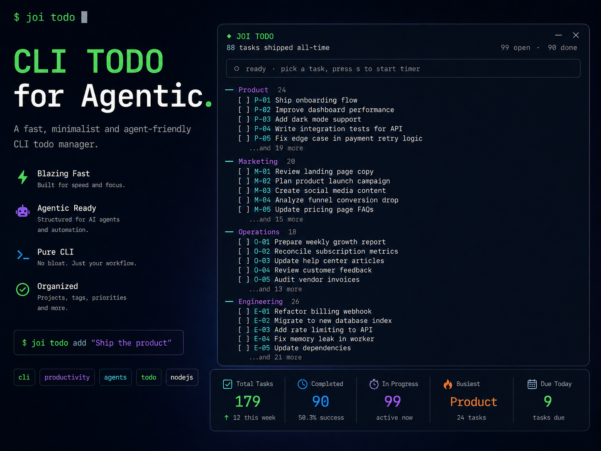

# cli-todo-for-agentic

<p align="center">
  
</p>

<p align="center">
  A terminal todo for people who ship.<br/>
  Fullscreen TUI · virtualized scroll · per-task timer · event-sourced storage · one-line daily manifesto.
</p>

---

## Why this exists

I got tired of todo apps that treated my week like an inbox. Tools that hid completed work behind three clicks. Web apps I had to leave my terminal for. Native apps that lost data on sync.

This one is small and opinionated:

- Opens in the terminal you already live in
- Categorizes work by brand/project the way an operator actually thinks
- Runs a timer on the active task so you know where your day went
- Groups completed work by day so tomorrow morning you see what yesterday looked like
- Shows a different one-line manifesto every day, deterministic, no notifications
- Stores everything as plain JSON + an append-only event log — no lock-in, no database, no cloud

If any of that resonates, keep reading.

## Screenshots

<p align="center">
  
</p>

## Install

```bash
git clone https://github.com/suleymanbagirgan/cli-todo-for-agentic
cd cli-todo-for-agentic
npm install
npm link          # exposes the `todo` command globally
```

Requires Node 20+ (uses ESM top-level await and native `node:` imports).

Uninstall cleanly with `npm unlink`. Your data stays in `~/.joi-todo/`.

## Your first five minutes

Open it:

```bash
todo
```

The terminal is taken over (alt-screen buffer, like `htop` or `less`). Header shows your lifetime shipped count, today's date, and today's manifesto. Below it, a timer box. Below that, your tasks, grouped by category.

Try:

```bash
todo add "ship the pricing page +web !! @tomorrow"
```

Reopen `todo` and press `s` on the new task — a timer starts. Press `h` to hold, `c` to complete. Press `q` to quit; your shell comes back exactly how you left it.

## Interactive shortcuts

| Key | Action |
|-----|--------|
| `j` / `↓` | Move cursor down |
| `k` / `↑` | Move cursor up |
| `g` / `G` | Jump to top / bottom |
| `^D` / `^U` / `PageDown` / `PageUp` | Move by 10 |
| `a` / `i` | Add task |
| `e` | Edit task under cursor |
| `c` / `space` / `Enter` | Complete / uncomplete |
| `d` / `x` | Delete task |
| `s` | Start / resume timer on task |
| `h` | Hold active timer |
| `u` | Undo last action |
| `/` | Filter by project |
| `F` | Clear filter |
| `r` | Refresh from disk |
| `Tab` (in add/edit) | Open project picker |
| `q` / `Esc` | Quit |

## CLI commands

Every keystroke has a scriptable equivalent so `todo` composes with your shell, cron, and agents.

```bash
todo                              # interactive TUI (default)
todo add "text +project !! @date" # add a task
todo list [+tag] [--flat]         # grouped or flat listing
todo top [days]                   # critical items in next N days (default 30)
todo done <ref>                   # toggle completion
todo edit <ref> "new text"        # edit
todo rm <ref>                     # delete
todo undo                         # reverse the last mutation
todo clear                        # remove completed tasks (undoable)
todo stats                        # counts (today/week, added/done, events)

todo start <ref>                  # start timer (auto-holds any active one)
todo hold                         # hold active timer
todo stop                         # stop active timer
todo now                          # what's currently running
todo time [today|week|month]      # time report per project

todo projects                     # list defined categories/projects
todo agent "question"             # ask Claude CLI about your list
todo sync [on|off|status]         # iCloud symlink toggle
todo path                         # show data file locations
```

`<ref>` is either a numeric id (`#12`) or a code (`BP-42`). Codes are stable per category.

## Task syntax

Tasks are just strings with a few natural tokens:

```
text +project !! @date
```

- `+project` — assigns to a project (which maps to a category via `config.json`)
- `!` / `!!` / `!!!` — low / medium / high priority
- `@today` / `@tomorrow` / `@yesterday` / `@YYYY-MM-DD` — due date

Turkish is understood too: `@bugün`, `@yarın`, `@dün`.

Example:

```bash
todo add "review the growth deck +marketing !! @tomorrow"
todo add "cancel the unused SaaS +ops @2026-09-01"
```

## The daily manifesto

Every day the header shows one line from a rotating list of 50. Deterministic — the same day always shows the same line, so you get one message per day, not per open.

50 defaults ship in `src/manifestos.js`. To override with your own quotes, create `~/.joi-todo/manifestos.js`:

```js
export const manifestos = [
  "Ship today. Excuses compound faster than assets.",
  "The market pays for shipped, not for sacred.",
  "You against you. Yesterday against today. Win.",
  // … as many as you like
];
```

The loader is defensive: if your personal file has a syntax error, is missing the export, or is empty, the app falls back to defaults. You never lose the tool because you had a typo.

## Under the hood

A few decisions that shaped the codebase:

- **Event-sourced** — every mutation writes an append-only line to `events.jsonl`. Undo, stats, time reports, and the lifetime `shipped` counter all read from this log. Data isn't the source of truth; the events are.
- **Atomic writes** — every save is `write to tmp` + `rename`. No partial writes, no half-saved JSON if you kill the process mid-write.
- **File locking** — cross-process lock in `os.tmpdir()` (never inside the synced data directory) so two `todo` invocations on the same machine don't stomp on each other, and iCloud sync can't create ghost locks between devices.
- **ID collision protection** — on every load, `nextId` is reconciled against `max(existing id) + 1`. `addTask` retries if the computed id already exists. Survives iCloud sync races.
- **Fullscreen TUI** — enters the alt-screen buffer on start (`\x1b[?1049h`), leaves it on exit. Your shell scrollback is preserved.
- **Virtualized scroll** — [`ink-scroll-view`](https://github.com/BytelandTechnology/ink-scroll-view) keeps the cursor visible without redrawing 100+ tasks per keystroke.
- **Ink + htm** — React for terminals via [Ink](https://github.com/vadimdemedes/ink), rendered with `htm` so there's no build step. Clone → `npm install` → run.

## Data & sync

Everything lives in `~/.joi-todo/`:

| File | What it holds |
|------|---------------|
| `tasks.json` | Current tasks, counters, category counters, lifetime stats |
| `events.jsonl` | Append-only log of every add/edit/toggle/start/stop/hold/remove/clear |
| `config.json` | Category and project definitions, optional per-category "missions" |
| `manifestos.js` | Your personal daily manifestos (optional, overrides bundled defaults) |

### iCloud sync (optional)

```bash
todo sync on
```

This symlinks `~/.joi-todo/` into `~/Library/Mobile Documents/com~apple~CloudDocs/joi-todo/`. Your tasks flow between Macs via iCloud.

**Important:** the lock file lives in `os.tmpdir()`, not in the synced directory, so it does not travel between devices. Concurrent editing across two machines can still race — last write wins. Treat one machine as primary at a time, or accept that a merge might drop the loser's last mutation. For most solo workflows this is fine.

`todo sync off` reverses the symlink.

## Architecture

```
bin/todo.js         CLI entry, meow-based command dispatch, alt-screen setup
src/App.js          Ink TUI: state, input handling, render
src/store.js        Persistence: loadRaw / save / event log / undoLast / migrations
src/actions.js      Higher-level ops (completeTask, deleteTask, startOrResume, holdActive)
src/timer.js        Active-timer file, elapsed calc, stale reconciliation, time reports
src/parse.js        Natural-language task syntax parser (+proj, !!!, @tomorrow, TR dates)
src/sort.js         Priority + due + status sorting, grouped variant for TUI
src/config.js       Categories, project ↔ category map
src/io.js           Atomic write + cross-process file lock with stale-detection
src/format.js       Task-part extraction for renderers
src/manifestos.js   50 default daily manifestos
```

Roughly 1,300 lines of code, no build step, no framework beyond Ink + React 19.

## Roadmap

Ideas I want to build next. If any of these excite you, open an issue or a PR — the fastest way to steer them is to prototype.

- **`todo pulse`** — brand starvation dashboard: how many days since each category last shipped
- **`--json` / `--ids` flags** — first-class shell citizen (`todo list --ids | xargs -I{} todo done {}`)
- **`todo now --oneline`** — one-line output for tmux status bars, sketchybar, etc.
- **`todo shutdown`** — daily closing ritual: park active timer, summarize the day, propose top 3 for tomorrow
- **Shell completions** — zsh / bash / fish
- **`node:test` coverage** — parse, sort, and undo are the most valuable to lock down
- **MCP server** — expose `list_tasks / add_task / complete_task` so Claude Code and other agents can compose with your backlog

## Contributing

Small tool, small surface. Contributions are very welcome — especially the boring stuff (tests, edge cases, docs typos).

**Before opening a PR:**

- Keep the CLI feeling like a CLI. Exit codes should be meaningful. Output should be pipeable when reasonable. No surprises.
- Match the existing style — no build step, no TypeScript, htm templates in Ink, `{ ok, msg }` returns instead of thrown errors for user-facing failures.
- If you touch the data layer, keep the append-only event log intact. Anything the app does should be replayable from `events.jsonl`.
- If you add a CLI subcommand, add a one-line description to `todo --help` and a short section to this README.

**Opening an issue:**

- What you tried to do
- What actually happened
- Steps to reproduce, if you have them

That's it. No template, no CLA.

## Prior art & thanks

- **[Ink](https://github.com/vadimdemedes/ink)** — React for terminals. Makes this whole app possible in a few hundred lines of UI code.
- **[ink-scroll-view](https://github.com/BytelandTechnology/ink-scroll-view)** — the virtualization that keeps the cursor visible in long lists.
- **[htm](https://github.com/developit/htm)** — JSX-like templates with no build step.
- **[meow](https://github.com/sindresorhus/meow)** — the CLI parser that stays out of the way.
- Everyone who ever taped a sticky note over "Inbox Zero" and wrote **"ship one thing"** instead.

## License

[MIT](LICENSE). Do whatever. If you build something with it, I'd love to see.
